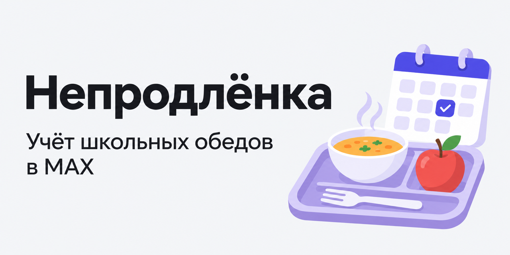

# Непродлёнка

[](https://github.com/vragovR/neprodlenka/actions/workflows/ci.yml)
[](https://github.com/vragovR/neprodlenka/releases/latest)

Бот для учёта школьных обедов в группе класса в MAX с веб-админкой.
Родители отмечают пропуски, а бот ведёт учёт питания и рассчитывает суммы к оплате за месяц.



## Возможности

- Ежедневное сообщение в группе: по умолчанию обедают все, родители нажимают «Не обедает» при пропуске.
- Расписание кружков и секций на день в сообщении бота.
- Разовые изменения кружков на дату: отмена, перенос времени или другой день — без правки постоянного расписания.
- Управление детьми, родителями, ценами обедов, днями посещения и неучебными днями через админку.
- Итоги месяца с суммами к оплате, реквизитами и отметками об оплате.
- Отчёты по ссылке без входа: общая таблица и календарь питания каждого ребёнка.

## Стек

Go, SQLite, Vue 3, TypeScript, Vite+, Docker Compose, nginx, Caddy. CI и деплой — GitHub Actions.

## Локальный запуск

Нужны Docker Compose с поддержкой `watch` и OrbStack либо Traefik для доступа к сайту.
Адрес в OrbStack — `https://neprodlenka.local`, в Traefik — `http://neprodlenka.test`.

1. Подготовить настройки из [шаблона](.env.dist):

   ```sh
   cp .env.dist .env
   ```

   В `.env` заполнить `MAX_TOKEN`, `PAYMENT_CARD`, `PAYMENT_RECIPIENT` и `JWT_SECRET`
   (сгенерировать: `openssl rand -hex 32`). Указать свой `BASE_URL`, оставить `MODE=polling`.

2. Запустить проект:

   ```sh
   make up
   ```

   Бэкенд и фронт обновляются при изменении файлов. Если ID группы неизвестен, оставить `MAX_CHAT_ID=0`,
   добавить бота в группу и найти `chat_id` в `make logs` по событию `bot_added`.
   Вписать ID в `.env` и пересоздать контейнеры: `make down`, затем `make up`.

3. В другом терминале создать администратора (пароль будет запрошен):

   ```sh
   docker compose exec backend go run ./cmd/neprodlenka admin add <login>
   ```

4. Открыть сайт по адресу из `BASE_URL`.

## Разработка

Для команд вне Docker нужны Go 1.27+, Node.js (`^22.18.0`, `^24.12.0` или `>=26.0.0`), npm и curl.
Команды выполняются из корня проекта:

| Команда | Назначение |
| --- | --- |
| `make install` | Установить зависимости, golangci-lint и Chromium для тестов. |
| `make lint test build` | Проверить код, запустить тесты и собрать проект. |
| `make logs` | Посмотреть логи контейнеров. |
| `make down` | Остановить проект. |

Об ошибках и предложениях пишите в [Issues](https://github.com/vragovR/neprodlenka/issues).

Лицензия — [MIT](LICENSE).
